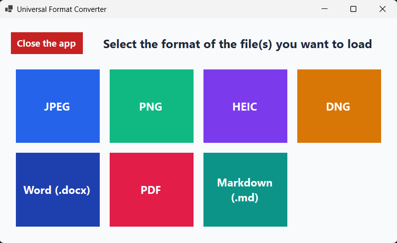
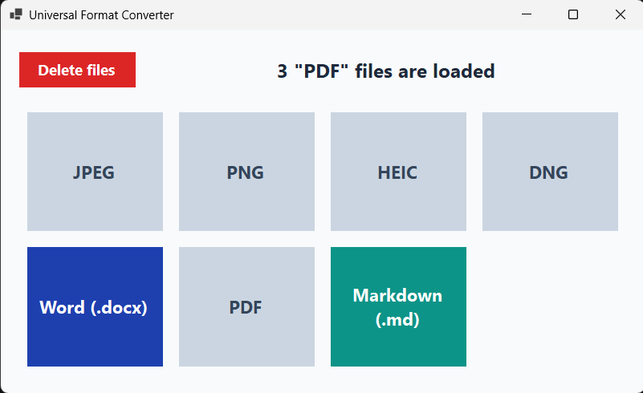
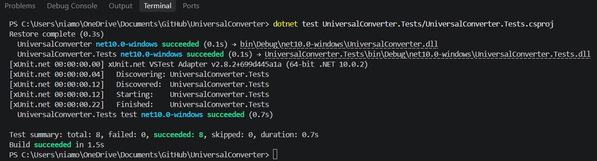

## 🔄 Universal Format Converter


[](https://github.com/frisko2305/UniversalConverter/releases)

Universal Format Converter is a fast, desktop-native utility that seamlessly bridges the gap between complex images (HEIC, DNG, ICO) and structured documents (Word, PDF, Markdown). Built with a highly responsive, identically mapped UI, it allows you to cross-convert files or batch-process entire directories into compressed .zip archives with zero friction.

The clean, color-coded launch menu to select your input format.



## ✨ Core Features

* **Cross-Category Conversion:** Seamlessly embed high-res images directly into .docx files or render them cleanly into .pdf documents.

* **Batch Processing & Auto-ZIP:** Drag a selection box over multiple files in the explorer; the engine processes them all and packs the output into a clean .zip archive.

* **RAW & Apple Device Support:** Native decoding for camera sensor files (.dng) and iPhone photos (.heic) without needing paid Windows store extensions.

* **Dynamic Matrix UI:** The interface intuitively grays out impossible or redundant conversion paths based on the exact file(s) you load.

* **Icon Creation (.ico):** Convert any supported image format directly into Windows-ready icon files with automatic dimension fitting (up to 256×256).

A file is loaded into the engine, with unsupported target formats automatically disabled.



---

## 🏗️ How It Works: "The UI vs. The Engine"

To ensure maximum performance and prevent UI freezing when handling 40 MB RAW files or heavy PDFs, this application divides responsibilities into two distinct layers:

1. **The Responsive UI:** Powered by an identical TableLayoutPanel grid. The window geometry never shifts between Step 1 and Step 2, preventing screen flicker. File loading and UI updates happen instantly on the main thread.

2. **The Background Engine:** Powered by Magick.NET, PDFsharp, and OpenXml. The ConversionEngine runs asynchronously (Task.Run). It manipulates the files entirely in-memory as byte[] arrays to eliminate slow hard-drive read/write bottlenecks. The disk is only touched at the very last second when the user confirms the Save dialog.

3. **🧪 Rigorous Testing Architecture**
The backend logic is mathematically verified using the xUnit testing framework. To prevent repository bloat, the test suite generates temporary dummy documents and .zip archives dynamically in memory, verifies their binary headers and extraction counts, and cleans them up instantly.

* **The suite guarantees:**

Cross-conversion rules are strictly enforced (e.g., blocking .docx to .dng).

Multi-file inputs correctly instantiate valid .zip archives.

Document structures are maintained upon byte extraction.

The automated test suite executing and passing all architectural checks.



---

## 🚀 Getting Started

You can run the application either by downloading the standalone executable (no installation required) or by building from source.

### Option 1: Quick Start (Standalone Executable - Recommended)

1. Head over to the **[Releases](https://github.com/frisko2305/UniversalConverter/releases)** tab.

2. Download `UniversalConverter.exe`.

3. Double-click the file to run it immediately — **no .NET installation or setup required**!

---

### Option 2: Build & Run from Source

#### Prerequisites

* [.NET 10.0 SDK](https://dotnet.microsoft.com/download/dotnet/10.0) or newer (Windows).

#### Clone & Run

Open PowerShell or your preferred terminal:
```bash
git clone https://github.com/frisko2305/UniversalConverter.git
cd UniversalConverter
dotnet run
```
Developed by Frisko2305.
